# Data Relationships & Relational Model Architecture

## 1. Overview & ER Diagram Architecture

The **Railway Reservation & Management System** is modeled in strict compliance with Third Normal Form (3NF) relational design in MySQL, augmented by a specialized MongoDB NoSQL cluster for operational logs, notifications, and real-time transit status feeds.

The data model directly implements the approved ER diagram (`database/FINALx4_Railway Reservation & Management System – ER Diagram.html`) and Section 16 of the Business Rules (`docs/BUSINESS_RULES.md`), incorporating the canonical IDs and structures of the five master datasets (158 stations, 60 trains with IDs 101–160, 536 route stops with IDs 1001–1536, 50,000 user accounts, and 75,000 saved passenger profiles).

```mermaid
erDiagram
    %% SECTION 1: USER / RESERVATION
    USER_ACCOUNT ||--o{ SAVED_PASSENGER : "owns"
    USER_ACCOUNT ||--o{ SEAT_HOLD : "initiates"
    USER_ACCOUNT ||--o{ BOOKING : "places"
    USER_ACCOUNT ||--o| STAFF : "authenticates"
    USER_ACCOUNT ||--o| ADMIN : "authenticates"
    USER_ACCOUNT ||--o{ AUDIT_LOG : "executes"

    BOOKING ||--|{ PASSENGER_BOOKING : "contains"
    BOOKING ||--o{ PAYMENT : "paid_by"
    BOOKING ||--o{ CANCELLATION : "cancelled_by"
    BOOKING ||--o{ TDR_FILING : "disputed_via"
    
    PASSENGER_BOOKING ||--o| RESERVATION : "allocates"
    PASSENGER_BOOKING }o--o| SAVED_PASSENGER : "profile_link"
    CONCESSION_RULE ||--o{ PASSENGER_BOOKING : "discounts"

    CANCELLATION ||--o| REFUND : "triggers"
    TDR_FILING ||--o| REFUND : "results_in"
    PAYMENT ||--o{ REFUND : "refunded_via"

    %% SECTION 2: RAILWAY INFRASTRUCTURE
    STATION ||--|{ PLATFORM : "has_platforms"
    STATION ||--o{ ROUTE_STOP : "stops_at"
    STATION ||--o{ TRAIN : "source_and_dest"
    
    TRAIN ||--|{ ROUTE_STOP : "ordered_stops"
    TRAIN ||--o{ TRAIN_SCHEDULE : "scheduled_runs"
    TRAIN ||--|{ COACH : "composed_of"
    
    SEAT_CLASS ||--o{ COACH : "class_spec"
    SEAT_CLASS ||--o{ FARE : "priced_by"
    SEAT_CLASS ||--o{ SCHEDULE_CLASS_INVENTORY : "stocked_in"
    
    COACH ||--|{ SEAT : "contains_seats"
    TRAIN_SCHEDULE ||--o{ SCHEDULE_CLASS_INVENTORY : "tracks_capacity"
    TRAIN_SCHEDULE ||--o{ RUN_COACH_STATUS : "coach_readiness"
    TRAIN_SCHEDULE ||--o{ CHART_SNAPSHOT : "freezes_manifest"
    RESERVATION }o--o| SEAT : "assigned_seat"

    %% SECTION 3: STAFF / OPERATIONS
    STAFF ||--o{ STAFF_ASSIGNMENT : "assigned_shifts"
    STAFF ||--o{ TICKET_VERIFICATION : "verifies"
    STAFF ||--o{ FINE : "issues"
    STAFF ||--o{ INCIDENT : "reports"
    STAFF ||--o{ MAINTENANCE : "performs"
    STAFF ||--o{ CROWD_REPORT : "records"
    STAFF ||--o{ CLEANLINESS_REPORT : "logs"

    TICKET_VERIFICATION ||--o{ FINE : "leads_to"
    MAINTENANCE }o--o| COACH : "services_coach"
    MAINTENANCE }o--o| PLATFORM : "services_platform"

    %% SECTION 4: ADMIN / SETTINGS
    ADMIN ||--o{ REPORT : "generates"
    SETTING ||--o{ BOOKING : "governs_rules"
```

---

## 2. Core Relational Clusters

### 2.1 User, Identity & Hold Cluster (Section 1)
- **`USER_ACCOUNT` (1) ── (0..N) `SAVED_PASSENGER`**:
  A single user account maintains a saved roster of family or frequent travelers. Concessions are selected dynamically during ticket booking and are not permanently stamped onto passenger profiles (BR-C10).
- **`USER_ACCOUNT` (1) ── (0..1) `SEAT_HOLD`**:
  When a user reaches Booking Step 3 (Passenger Details), the system creates an active temporary hold token valid for 10 minutes (BR-B2). At most one active hold is allowed per user.
- **`USER_ACCOUNT` (1) ── (0..N) `BOOKING`**:
  Customers own their booking transactions and PNRs. A user can create at most 12 bookings per calendar month, or 24 if `aadhaar_verified` is true (BR-B15). The system account `COUNTER_WALKIN` is exempt.
- **`USER_ACCOUNT` (1) ── (0..1) `STAFF` / `ADMIN`**:
  Personnel login records join 1-to-1 with operational staff profiles or administrator credentials.

---

### 2.2 Infrastructure, Timetable & Inventory Cluster (Section 2)
- **`STATION` (1) ── (1..N) `PLATFORM`**:
  Every station (IDs 1–158) has a defined `platform_count` (raised to a minimum of 3 for busy junction stations per BR-A9), with corresponding `PLATFORM` records numbered 1 through `platform_count`.
- **`TRAIN` (1) ── (1..N) `ROUTE_STOP`**:
  The 60 trains (IDs 101–160) operate over 536 ordered stops (IDs 1001–1536). Each stop records `stop_sequence` (1, 2, 3...), arrival/departure times, `day_offset` (0, 1, or 2 days elapsed from origin departure), cumulative distance from origin, and designated platform.
- **`TRAIN` (1) ── (0..N) `TRAIN_SCHEDULE`**:
  Defines dated calendar runs. The single master clock for refund calculations and chart preparation is the **scheduled departure of the train from its origin station** on the journey date (BR-1). `running_days` in `TRAIN` determines which calendar dates operate.
- **`TRAIN` (1) ── (1..N) `COACH` ── (1..N) `SEAT`**:
  Standard train compositions (Rajdhani, Shatabdi, Duronto, Express) contain physical coaches and seats with specific berth types (`LOWER`, `MIDDLE`, `UPPER`, `SIDE_LOWER`, `SIDE_UPPER`, `WINDOW`, `AISLE`, `NO_BERTH`).
- **`TRAIN_SCHEDULE` & `SEAT_CLASS` (1) ── (1..N) `SCHEDULE_CLASS_INVENTORY`**:
  Seat availability is maintained per run, per class, and **per quota** (`GENERAL`, `LADIES`, `TATKAL`, `SENIOR_CITIZEN`, `DIVYAANG`) (BR-Q10). RAC and waiting list counters are tracked strictly for `GENERAL` and `TATKAL` (BR-Q12).

---

### 2.3 Booking, Fare, Settlement & Refund Cluster (Section 1)
- **`BOOKING` (1) ── (1..6) `PASSENGER_BOOKING`**:
  One PNR holds 1 to 6 passengers (maximum 4 for Tatkal). Each passenger record carries an itemized fare breakdown:
  $$\text{Base Fare} - \text{Concession} + \text{Reservation} + \text{Superfast} + \text{Tatkal} + \text{Dynamic Surcharge} + \text{GST} + \text{Insurance}$$
  Concessions are limited to `DIVYAANG` (active) and `SENIOR_CITIZEN` (inactive setting).
- **`PASSENGER_BOOKING` (1) ── (0..1) `RESERVATION`**:
  Tracks current status (`CONFIRMED`, `RAC`, `WAITING_LIST`, `BOARDED`, `NO_SHOW`, `CANCELLED`), physical `seat_id` (NULL for WL), and numeric queue position.
- **`BOOKING` (1) ── (0..N) `PAYMENT`**:
  Monetary payments via Razorpay TEST mode (`gateway_payment_id` is unique and idempotent) or `CASH` at station counters.
- **`BOOKING` / `PASSENGER_BOOKING` ── `CANCELLATION` & `TDR_FILING` ── `REFUND`**:
  - Voluntary cancellations apply origin-departure deduction slabs (>72 hrs: flat min, 72–24 hrs: 25%, 24–8 hrs: 50%, <8 hrs: closed).
  - TDR claims for railway faults (`TRAIN_DELAYED_OVER_3_HOURS`, `TRAIN_DIVERTED`, `CLASS_DOWNGRADED`, `AC_FAILURE`, `COACH_NOT_ATTACHED`, `TRAIN_TERMINATED_SHORT`).
  - Late payments arriving after hold expiry generate automatic full refunds (`reason: PAYMENT_AFTER_EXPIRY`, BR-B14).
- **`TRAIN_SCHEDULE` (1) ── (1..N) `CHART_SNAPSHOT`**:
  At chart time (8 hours before origin departure per BR-B12 / settings table), an immutable passenger manifest is saved and never modified, serving as the baseline for TC ticket checking (BR-B12a).

---

### 2.4 Staff Operations & Maintenance Cluster (Section 3)
- **`STAFF` (1) ── (0..N) `STAFF_ASSIGNMENT`**:
  Assigns staff to shifts across four duty types: `TRAIN_DUTY`, `STATION_DUTY`, `COUNTER_DUTY`, `MAINTENANCE_DUTY`.
- **`STAFF` (1) ── (0..N) `TICKET_VERIFICATION` & `FINE`**:
  On-train ID and concession proof inspection (`VALID`, `INVALID`, `MISMATCH`) and penalty issuance.
- **`STAFF` (1) ── (0..N) `MAINTENANCE`**:
  Work orders for coach or platform repair/cleaning. Enforces CHECK constraint: exactly one of `coach_id` or `platform_id` must be populated.
- **`STAFF` (1) ── (0..N) `CROWD_REPORT` & `CLEANLINESS_REPORT` & `INCIDENT`**:
  Platform crowd monitoring, coach hygiene tracking, and emergency incident reporting.

---

### 2.5 Admin & Settings Cluster (Section 4)
- **`ADMIN` (1) ── (0..N) `REPORT`**: Operational analytics metadata.
- **`USER_ACCOUNT` (1) ── (0..N) `AUDIT_LOG`**: Trigger-filled immutable change trail.
- **`SETTING`**: Key-value table storing configurable rules (e.g. `BOOKING_WINDOW_DAYS: 7`, `HOLD_MINUTES: 10`, `DYNAMIC_FARE_ENABLED: false`).

---

### 2.6 MongoDB NoSQL Layer (Section 5)
MongoDB collections decouple high-velocity event tracking and variable-schema payloads from the relational core:
- **`live_train_status` (`LTS`)**: Replicated train schedule delay minutes and platform feeds.
- **`notifications` (`NTF`)**: Targeted in-app alerts (`BOOKING_CONFIRMATION`, `STATUS_UPDATE`, `DELAY`, `PLATFORM_CHANGE`, `EMERGENCY`).
- **`complaints` (`CMP`)**: Polymorphic passenger grievance records.
- **`activity_logs` (`ACT`)**: User login events and API audit traces.
- **`raw_gateway_replies`**: Raw Razorpay webhook payloads.

---

## 3. Segmented Seat Allocation & Seat Integrity Rules

### 3.1 Non-Overlapping Segment Rule (BR-S4)
A single physical seat (`coach_id`, `seat_no`) on a given train schedule run may be sold to two different passengers if and only if their travel segments do not overlap in route stop sequence:

$$\max(\text{Start}_A, \text{Start}_B) < \min(\text{End}_A, \text{End}_B)$$

Where $\text{Start}$ and $\text{End}$ are the 1-indexed `stop_sequence` numbers along the route:
- If $\max(\text{Start}_A, \text{Start}_B) < \min(\text{End}_A, \text{End}_B)$, the journeys overlap $\implies$ **REJECTED (SEAT_NOT_AVAILABLE)**.
- If $\max(\text{Start}_A, \text{Start}_B) \ge \min(\text{End}_A, \text{End}_B)$, the journeys are disjoint $\implies$ **VALID & ALLOWED**.
- *Example*: Passenger A travels from Stop 1 to Stop 3. Passenger B travels from Stop 3 to Stop 5. Because $\max(1, 3) = 3$ and $\min(3, 5) = 3$, $3 < 3$ is false. The segments do not overlap; both passengers legally share the seat across their respective legs!

### 3.2 RAC Berth Sharing Exception (BR-S5)
The only permitted exception to the overlap rule: **up to two RAC passengers may share one `SIDE_LOWER` berth** even if their travel segments overlap. When an RAC passenger is promoted to confirmed status (via cancellation, no-show, or chart release), they move into a full, unshared berth.

### 3.3 Auto-Upgrade Promotion Pipeline (BR-S6, BR-W4)
When an auto-upgraded passenger moves to a higher class at chart time, the seat they vacated in the lower class immediately initiates RAC/WL promotion in that old class within the same atomic transaction:
1. Vacated lower-class seat is assigned to the lowest-numbered RAC passenger whose travel segment fits the stops.
2. The newly opened RAC slot is assigned to the lowest-numbered Waiting List passenger.

---

## 4. Integrity Constraints & Business Logic Enforcements

The following integrity constraints and mechanisms represent design implementations (proposed design) to enforce business rules:
1. **Composite Foreign Key (pnr, passenger_no)**: `PASSENGER_BOOKING` uses `(pnr, passenger_no)` as a composite primary key. Child tables (`RESERVATION`, `TICKET_VERIFICATION`, `CANCELLATION`, `TDR_FILING`) reference it. In MySQL/InnoDB, a NULL `passenger_no` in `CANCELLATION` or `TDR_FILING` skips the line-item check and applies to the entire PNR.
2. **One Active Seat Allocation**: `RESERVATION` enforces `UNIQUE(schedule_id, active_seat_id)` where `active_seat_id` is a virtual/generated column populated only when status is `CONFIRMED` or `RAC`. Cancelled and waitlisted passengers have NULL and never conflict.
3. **Seat Validity Trigger**: Cross-table integrity verifies that `SEAT → COACH → TRAIN` strictly matches the `TRAIN_SCHEDULE.train_id` of the reservation.
4. **Route Directionality**: For every booking, `from_stop_id` and `to_stop_id` must belong to the schedule's route, satisfying `from_stop.stop_sequence < to_stop.stop_sequence`.
5. **Maintenance CHECK Constraint**: In `MAINTENANCE`, exactly one of `coach_id` or `platform_id` must be non-null:
   `CHECK ((coach_id IS NOT NULL AND platform_id IS NULL) OR (coach_id IS NULL AND platform_id IS NOT NULL))`.
6. **Chart Preparation Lockout (BR-B12a, BR-B16)**: At chart time (8 hours before origin departure per BR-B12 / settings table), executed as one all-or-nothing step: new bookings are rejected with `CHART_PREPARED`, online cancellations close, active holds cancel, unsold quota seats move to GENERAL and promote, auto-upgrades run in booking order with old-class promotion, waitlists purge with full refund, and `CHART_SNAPSHOT` is permanently saved.

---

## 5. Foreign Key Constraints Reference

| Source Entity | Source Field | Target Entity | Target Field | On Delete Action |
| :--- | :--- | :--- | :--- | :--- |
| `SAVED_PASSENGER` | `user_id` | `USER_ACCOUNT` | `user_id` | `RESTRICT` |
| `SEAT_HOLD` | `user_id` | `USER_ACCOUNT` | `user_id` | `CASCADE` |
| `SEAT_HOLD` | `schedule_id` | `TRAIN_SCHEDULE` | `schedule_id` | `CASCADE` |
| `SEAT_HOLD` | `class_id` | `SEAT_CLASS` | `class_id` | `RESTRICT` |
| `BOOKING` | `user_id` | `USER_ACCOUNT` | `user_id` | `RESTRICT` |
| `BOOKING` | `schedule_id` | `TRAIN_SCHEDULE` | `schedule_id` | `RESTRICT` |
| `BOOKING` | `class_id` | `SEAT_CLASS` | `class_id` | `RESTRICT` |
| `BOOKING` | `from_stop_id` | `ROUTE_STOP` | `stop_id` | `RESTRICT` |
| `BOOKING` | `to_stop_id` | `ROUTE_STOP` | `stop_id` | `RESTRICT` |
| `BOOKING` | `booked_by_staff_id`| `STAFF` | `staff_id` | `SET NULL` |
| `PASSENGER_BOOKING`| `pnr` | `BOOKING` | `pnr` | `CASCADE` |
| `PASSENGER_BOOKING`| `saved_passenger_id`| `SAVED_PASSENGER` | `passenger_id` | `SET NULL` |
| `RESERVATION` | `pnr` | `BOOKING` | `pnr` | `CASCADE` |
| `RESERVATION` | `schedule_id` | `TRAIN_SCHEDULE` | `schedule_id` | `CASCADE` |
| `RESERVATION` | `seat_id` | `SEAT` | `seat_id` | `RESTRICT` |
| `PAYMENT` | `pnr` | `BOOKING` | `pnr` | `SET NULL` |
| `CANCELLATION` | `pnr` | `BOOKING` | `pnr` | `RESTRICT` |
| `TDR_FILING` | `pnr` | `BOOKING` | `pnr` | `RESTRICT` |
| `TDR_FILING` | `reviewed_by` | `USER_ACCOUNT` | `user_id` | `SET NULL` |
| `REFUND` | `cancel_id` | `CANCELLATION` | `cancel_id` | `SET NULL` |
| `REFUND` | `tdr_ref_no` | `TDR_FILING` | `tdr_ref_no` | `SET NULL` |
| `REFUND` | `payment_id` | `PAYMENT` | `payment_id` | `RESTRICT` |
| `CHART_SNAPSHOT` | `schedule_id` | `TRAIN_SCHEDULE` | `schedule_id` | `CASCADE` |
| `CHART_SNAPSHOT` | `from_station_id` | `STATION` | `station_id` | `RESTRICT` |
| `CHART_SNAPSHOT` | `to_station_id` | `STATION` | `station_id` | `RESTRICT` |
| `PLATFORM` | `station_id` | `STATION` | `station_id` | `CASCADE` |
| `TRAIN` | `source_station_id`| `STATION` | `station_id` | `RESTRICT` |
| `TRAIN` | `destination_station_id`| `STATION` | `station_id` | `RESTRICT` |
| `ROUTE_STOP` | `train_id` | `TRAIN` | `train_id` | `CASCADE` |
| `ROUTE_STOP` | `station_id` | `STATION` | `station_id` | `RESTRICT` |
| `TRAIN_SCHEDULE` | `train_id` | `TRAIN` | `train_id` | `CASCADE` |
| `RUN_COACH_STATUS` | `schedule_id` | `TRAIN_SCHEDULE` | `schedule_id` | `CASCADE` |
| `RUN_COACH_STATUS` | `coach_id` | `COACH` | `coach_id` | `CASCADE` |
| `COACH` | `train_id` | `TRAIN` | `train_id` | `CASCADE` |
| `COACH` | `class_id` | `SEAT_CLASS` | `class_id` | `RESTRICT` |
| `SEAT` | `coachId` | `COACH` | `coach_id` | `CASCADE` |
| `SCHEDULE_CLASS_INVENTORY` | `schedule_id` | `TRAIN_SCHEDULE` | `schedule_id` | `CASCADE` |
| `SCHEDULE_CLASS_INVENTORY` | `class_id` | `SEAT_CLASS` | `class_id` | `RESTRICT` |
| `FARE` | `class_id` | `SEAT_CLASS` | `class_id` | `RESTRICT` |
| `CONCESSION_RULE` | `class_id` | `SEAT_CLASS` | `class_id` | `RESTRICT` |
| `STAFF` | `user_id` | `USER_ACCOUNT` | `user_id` | `RESTRICT` |
| `STAFF_ASSIGNMENT` | `staff_id` | `STAFF` | `staff_id` | `CASCADE` |
| `STAFF_ASSIGNMENT` | `schedule_id` | `TRAIN_SCHEDULE` | `schedule_id` | `SET NULL` |
| `STAFF_ASSIGNMENT` | `station_id` | `STATION` | `station_id` | `SET NULL` |
| `TICKET_VERIFICATION` | `pnr` | `BOOKING` | `pnr` | `CASCADE` |
| `TICKET_VERIFICATION` | `staff_id` | `STAFF` | `staff_id` | `RESTRICT` |
| `FINE` | `verify_id` | `TICKET_VERIFICATION` | `verify_id` | `SET NULL` |
| `FINE` | `staff_id` | `STAFF` | `staff_id` | `RESTRICT` |
| `INCIDENT` | `staff_id` | `STAFF` | `staff_id` | `RESTRICT` |
| `MAINTENANCE` | `staff_id` | `STAFF` | `staff_id` | `RESTRICT` |
| `MAINTENANCE` | `coach_id` | `COACH` | `coach_id` | `SET NULL` |
| `MAINTENANCE` | `platform_id` | `PLATFORM` | `platform_id` | `SET NULL` |
| `CROWD_REPORT` | `station_id` | `STATION` | `station_id` | `RESTRICT` |
| `CROWD_REPORT` | `staff_id` | `STAFF` | `staff_id` | `RESTRICT` |
| `CLEANLINESS_REPORT`| `staff_id` | `STAFF` | `staff_id` | `RESTRICT` |
| `ADMIN` | `user_id` | `USER_ACCOUNT` | `user_id` | `RESTRICT` |
| `AUDIT_LOG` | `user_id` | `USER_ACCOUNT` | `user_id` | `RESTRICT` |
| `REPORT` | `admin_id` | `ADMIN` | `admin_id` | `RESTRICT` |
